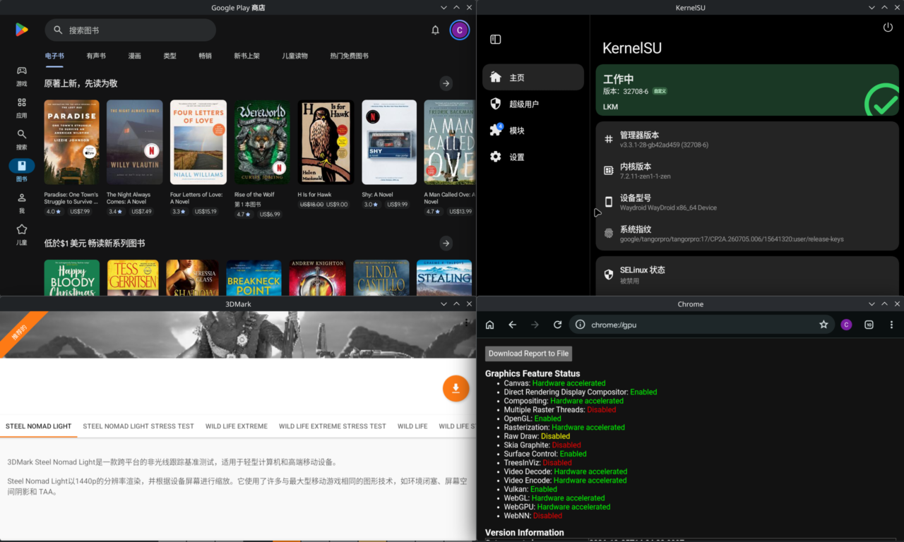
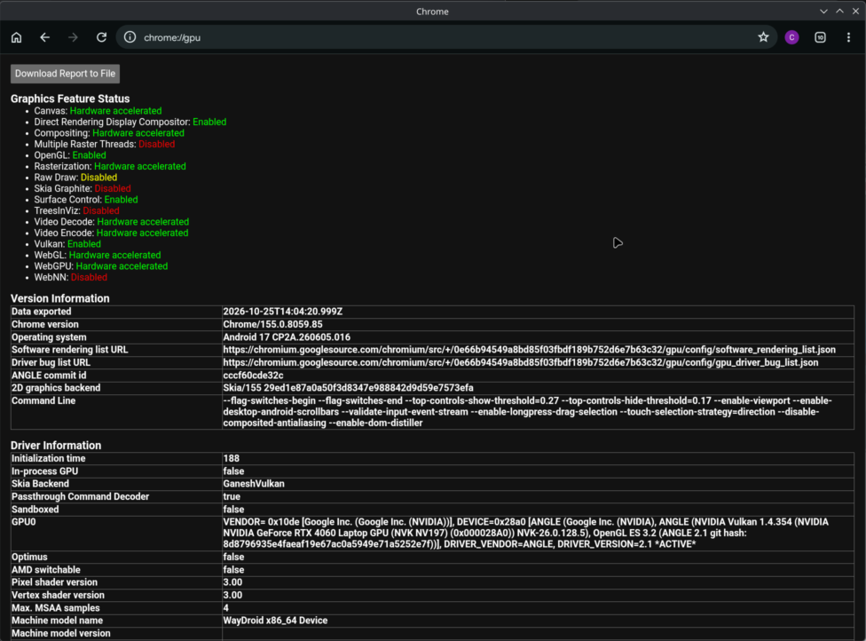
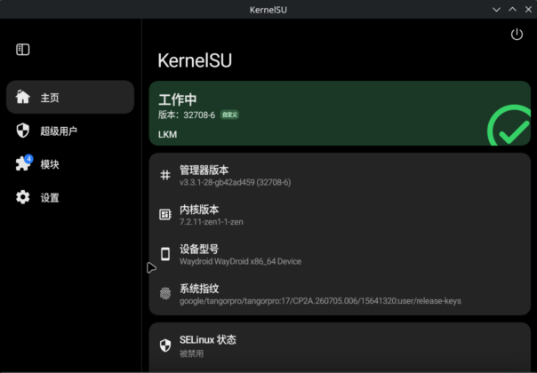

<div align="center">

# Waydroid A17 NVIDIA

**Android 17 on your Linux desktop, accelerated by your NVIDIA GPU.**
**在 Linux 桌面上跑 Android 17，用 NVIDIA 显卡硬件加速。**

[](https://github.com/cagedbird043/waydroid-a17-nvidia/releases/latest)
[](https://aur.archlinux.org/packages/waydroid-a17-nvidia-bin)


[](LICENSE)

[English](#english) · [中文](#中文)



</div>

---

## English

LineageOS 24.0 (Android 17) in Waydroid, with the GPU, the video engines, root and the desktop all working together:
Vulkan and GLES on NVIDIA through NVK, hardware video decode **and encode**, KernelSU, and every Android app as its own
KDE window.

### ✨ Highlights

| | Feature | |
|---|---|---|
| 🎮 | **GPU acceleration** | ANGLE → NVK → NVIDIA kernel driver; HWUI renders with Vulkan. WebGL and WebGPU work in Chrome. |
| 🎬 | **Hardware video decode** | H.264, HEVC, VP9 and AV1 on NVDEC — YouTube, Chrome and players use it automatically. |
| 📡 | **Hardware video encode** | H.264, HEVC and AV1 on NVENC. Chrome WebCodecs and WebRTC (video calls) encode on the GPU. |
| 🪟 | **Apps as desktop windows** | Each Android app gets its own KDE window; KWin moves, resizes and closes it. Positions are remembered. |
| ⌨️ | **Host input method** | Type in Android with fcitx5 or ibus; the candidate window follows the cursor. |
| 📋 | **Clipboard and files** | Two-way clipboard. `~/Downloads` shows up in Android as `Download/Host`. |
| 🖱️ | **Mouse as touch** | Drags become finger swipes in apps that ignore the mouse (Play Store and other Compose UIs). |
| 🔓 | **Root** | KernelSU on the host kernel, with modules (Zygisk Next, LSPosed and friends). |
| 🛒 | **Google apps** | Use ATV's GAPPS system image; Play Store is certified. |

### 📸 Screenshots

| Chrome: everything hardware accelerated | YouTube on NVDEC |
|---|---|
|  |  |

| KernelSU working | |
|---|---|
|  | |

### 🚀 Performance

| Benchmark (4K, Vulkan) | Host, NVIDIA driver | Waydroid | |
|---|---|---|---|
| Basemark GPU, Medium, offscreen | 35657 | 29369 | 82 % |
| 3DMark Wild Life Extreme | — | 12300–13100 (≈ 74 FPS) | |

| Encode, 1080p, RTX 4060 Laptop | H.264 | HEVC | AV1 |
|---|---|---|---|
| GPU time per frame | 1.7–2.4 ms | 2.0 ms | 1.4 ms |

Basemark on Android only ships ETC2 textures, which NVK has to emulate, while the host uses BC7, so the comparison
favours the host. Details in [`reports/`](reports/).

### 📦 Install (Arch Linux)

```bash
yay -S waydroid-a17-nvidia-bin
```

Then add the system image ([WayDroid-ATV `20261017`](https://github.com/WayDroid-ATV/waydroid-builds/releases/tag/20261017), GAPPS or VANILLA) and set up:

```bash
sudo mkdir -p /etc/waydroid-extra/images
sudo bsdtar -xf lineage-24.0-20261017-GAPPS-waydroid_x86_64-system.zip -C /etc/waydroid-extra/images system.img
sudo bsdtar -xf /usr/lib/waydroid-nvidia/vendor/waydroid-nvidia-vendor-x86_64-*.zip -C /etc/waydroid-extra/images vendor.img
sudo waydroid init -f
sudo waydroid-nvidia-setup      # tests the vendor image on your GPU, then installs it
waydroid prop set persist.waydroid.multi_windows true
waydroid session start
```

Needs the NVIDIA **open** kernel modules and binder (binderfs). Run `sudo waydroid-nvidia-setup` again after an
NVIDIA driver update. Root: [`kernelsu/`](kernelsu/).

<details>
<summary>Other distributions</summary>

From [Releases](https://github.com/cagedbird043/waydroid-a17-nvidia/releases/latest), take the vendor image (in parts) and
the native driver bundle of the same version:

```bash
cat vendor.img.zst.part* > vendor.img.zst && zstd -d vendor.img.zst
sha256sum -c vendor.img.zst.sha256
```

Install the host side of [waydroid-nvidia](https://github.com/Shiro836/waydroid-nvidia) with `patches/waydroid-nvidia/`
applied, extract the bundle into `/usr/lib/waydroid-nvidia/native/release/`, put `system.img` and `vendor.img` into
`/etc/waydroid-extra/images/` and run `waydroid-nvidia-setup`. The [PKGBUILD](aur/waydroid-a17-nvidia-bin/PKGBUILD)
shows the exact layout.
</details>

<details>
<summary>Handy switches</summary>

| Command | Effect |
|---|---|
| `waydroid prop set persist.waydroid.multi_windows true` | One KDE window per app |
| `waydroid show-full-ui` | The whole Android desktop in one window |
| `waydroid prop set persist.waydroid.fake_touch "com.android.vending"` | Mouse drags as touch in these apps (`*` = all) |
| `waydroid prop set persist.waydroid.nvidia_video_decode off` | Software video decoding |
| `waydroid prop set persist.waydroid.nvidia_video_encode off` | Software video encoding |

Folders shared into Android: `shared_folders` in the `[waydroid]` section of `/var/lib/waydroid/waydroid.cfg`, one
`host folder:storage path` per line. The KWin script that remembers window positions: System Settings → Window
Management → KWin Scripts → "Waydroid card placement".
</details>

> [!NOTE]
> A personal project, tested on one machine: RTX 4060 Laptop, NVIDIA open driver 615.78.08, KDE Plasma 6 Wayland,
> Arch Linux. Widevine is L3, so streaming apps usually play SD. Issues and PRs are welcome; replies are not guaranteed.

### 🙏 Acknowledgements

- [Shiro836/waydroid-nvidia](https://github.com/Shiro836/waydroid-nvidia) — the nvidia-prolapse mode, NVK and the Rust RM driver, ANGLE, the NVDEC Codec2 component and most hwcomposer fixes. This project would not exist without it.
- [WayDroid-ATV](https://github.com/WayDroid-ATV) (supechicken) — the Android 17 system image and device tree, and [KernelSU for Waydroid](https://github.com/supechicken/KernelSU).
- [mickys/nvenc](https://github.com/mickys/nvenc) — the NVENC encoder core; [NVIDIA/open-gpu-doc](https://github.com/NVIDIA/open-gpu-doc) — the NVENC class headers.
- [Waydroid](https://github.com/waydroid/waydroid), [LineageOS](https://lineageos.org), [KernelSU](https://github.com/tiann/KernelSU), [Mesa](https://mesa3d.org), [ANGLE](https://chromium.googlesource.com/angle/angle), and the authors of the wayland-protocols `text-input-v3` and `ext-data-control-v1`.

Original code here is [MIT](LICENSE). The patches under `patches/` keep their upstream licenses (Apache-2.0, BSD-3-Clause,
MIT/HPND, GPL-3.0 as appropriate) and `nvidia-product/` keeps waydroid-nvidia's; the vendor image contains these
projects under their own licenses.

---

## 中文

Waydroid 里的 LineageOS 24.0（Android 17），显卡、视频引擎、root 和桌面都打通：Vulkan 和 GLES 经 NVK 跑在 NVIDIA 上，
视频硬解**和硬编**，KernelSU，每个安卓应用都是一个独立的 KDE 窗口。

### ✨ 亮点

| | 功能 | |
|---|---|---|
| 🎮 | **GPU 加速** | ANGLE → NVK → NVIDIA 内核驱动，HWUI 用 Vulkan 渲染。Chrome 里 WebGL、WebGPU 都能用。 |
| 🎬 | **视频硬解** | H.264、HEVC、VP9、AV1 走 NVDEC，YouTube、Chrome 和播放器自动使用。 |
| 📡 | **视频硬编** | H.264、HEVC、AV1 走 NVENC。Chrome 的 WebCodecs 和 WebRTC（视频通话）用显卡编码。 |
| 🪟 | **应用即桌面窗口** | 每个安卓应用一个 KDE 窗口，由 KWin 移动、缩放、关闭，记住上次的位置。 |
| ⌨️ | **宿主输入法** | 用 fcitx5、ibus 直接在安卓里打字，候选框跟随光标。 |
| 📋 | **剪贴板与文件** | 剪贴板双向同步；`~/Downloads` 在安卓里就是 `Download/Host`。 |
| 🖱️ | **鼠标当触摸** | 在不认鼠标拖动的应用（Play 商店等 Compose 界面）里，拖动变成手指滑动。 |
| 🔓 | **Root** | 宿主内核上的 KernelSU，支持模块（Zygisk Next、LSPosed 等）。 |
| 🛒 | **Google 应用** | 用 ATV 的 GAPPS system 镜像，Play 商店已认证。 |

### 📸 截图

| Chrome：全部硬件加速 | YouTube 走 NVDEC |
|---|---|
|  |  |

| KernelSU 工作中 | |
|---|---|
|  | |

### 🚀 性能

| 测试（4K，Vulkan） | 宿主 NVIDIA 官方驱动 | Waydroid | |
|---|---|---|---|
| Basemark GPU，Medium，离屏 | 35657 | 29369 | 82 % |
| 3DMark Wild Life Extreme | — | 12300–13100（约 74 FPS） | |

| 编码，1080p，RTX 4060 Laptop | H.264 | HEVC | AV1 |
|---|---|---|---|
| 每帧 GPU 耗时 | 1.7–2.4 ms | 2.0 ms | 1.4 ms |

安卓版 Basemark 只带 ETC2 纹理，NVK 要模拟，宿主用的是 BC7，所以这项对比对宿主有利。详见 [`reports/`](reports/)。

### 📦 安装（Arch Linux）

```bash
yay -S waydroid-a17-nvidia-bin
```

再放入 system 镜像（[WayDroid-ATV `20261017`](https://github.com/WayDroid-ATV/waydroid-builds/releases/tag/20261017)，GAPPS 或 VANILLA）并初始化：

```bash
sudo mkdir -p /etc/waydroid-extra/images
sudo bsdtar -xf lineage-24.0-20261017-GAPPS-waydroid_x86_64-system.zip -C /etc/waydroid-extra/images system.img
sudo bsdtar -xf /usr/lib/waydroid-nvidia/vendor/waydroid-nvidia-vendor-x86_64-*.zip -C /etc/waydroid-extra/images vendor.img
sudo waydroid init -f
sudo waydroid-nvidia-setup      # 先在你的显卡上测试 vendor 镜像，通过后再装上
waydroid prop set persist.waydroid.multi_windows true
waydroid session start
```

需要 NVIDIA **open** 内核模块和 binder（binderfs）。NVIDIA 驱动更新后再跑一次 `sudo waydroid-nvidia-setup`。
Root 见 [`kernelsu/`](kernelsu/)。

<details>
<summary>其他发行版</summary>

从 [Releases](https://github.com/cagedbird043/waydroid-a17-nvidia/releases/latest) 下载同一版的 vendor 镜像（分块）和 native 驱动包：

```bash
cat vendor.img.zst.part* > vendor.img.zst && zstd -d vendor.img.zst
sha256sum -c vendor.img.zst.sha256
```

安装打上 `patches/waydroid-nvidia/` 的 [waydroid-nvidia](https://github.com/Shiro836/waydroid-nvidia) 主机部分，把驱动包解压到
`/usr/lib/waydroid-nvidia/native/release/`，`system.img` 和 `vendor.img` 放进 `/etc/waydroid-extra/images/`，运行
`waydroid-nvidia-setup`。文件布局以 [PKGBUILD](aur/waydroid-a17-nvidia-bin/PKGBUILD) 为准。
</details>

<details>
<summary>常用开关</summary>

| 命令 | 作用 |
|---|---|
| `waydroid prop set persist.waydroid.multi_windows true` | 每个应用一个 KDE 窗口 |
| `waydroid show-full-ui` | 在一个窗口里打开整个安卓桌面 |
| `waydroid prop set persist.waydroid.fake_touch "com.android.vending"` | 这些应用里鼠标拖动当触摸（`*` 为全部） |
| `waydroid prop set persist.waydroid.nvidia_video_decode off` | 视频改用软解 |
| `waydroid prop set persist.waydroid.nvidia_video_encode off` | 视频改用软编 |

共享给安卓的目录：`/var/lib/waydroid/waydroid.cfg` 的 `[waydroid]` 里配 `shared_folders`，每行一个 `主机目录:存储路径`。
记住窗口位置的 KWin 脚本：系统设置 → 窗口管理 → KWin 脚本 →「Waydroid card placement」。
</details>

> [!NOTE]
> 个人项目，只在一台机器上测过：RTX 4060 Laptop、NVIDIA open 驱动 615.78.08、KDE Plasma 6 Wayland、Arch Linux。
> Widevine 是 L3，流媒体应用一般只给标清。欢迎 issue 和 PR，但不保证回复。

### 🙏 致谢

- [Shiro836/waydroid-nvidia](https://github.com/Shiro836/waydroid-nvidia)：nvidia-prolapse 模式、NVK 与 Rust RM 驱动、ANGLE、NVDEC Codec2 组件和大部分 hwcomposer 修正。没有它就没有这个项目。
- [WayDroid-ATV](https://github.com/WayDroid-ATV)（supechicken）：Android 17 system 镜像与设备树，以及 [Waydroid 版 KernelSU](https://github.com/supechicken/KernelSU)。
- [mickys/nvenc](https://github.com/mickys/nvenc)：NVENC 编码核心；[NVIDIA/open-gpu-doc](https://github.com/NVIDIA/open-gpu-doc)：NVENC 类头文件。
- [Waydroid](https://github.com/waydroid/waydroid)、[LineageOS](https://lineageos.org)、[KernelSU](https://github.com/tiann/KernelSU)、[Mesa](https://mesa3d.org)、[ANGLE](https://chromium.googlesource.com/angle/angle)，以及 wayland-protocols 中 `text-input-v3`、`ext-data-control-v1` 的作者们。

本仓库的原创代码按 [MIT](LICENSE) 提供。`patches/` 下的补丁沿用各上游许可证（Apache-2.0、BSD-3-Clause、MIT/HPND、GPL-3.0），
`nvidia-product/` 沿用 waydroid-nvidia 的许可证；vendor 镜像中的各项目遵循各自的许可证。
